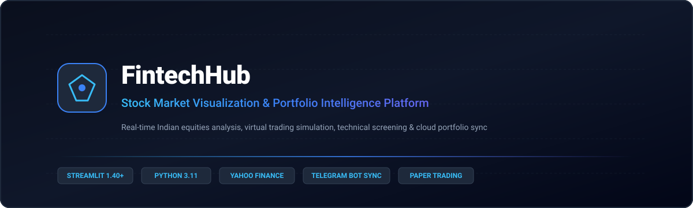
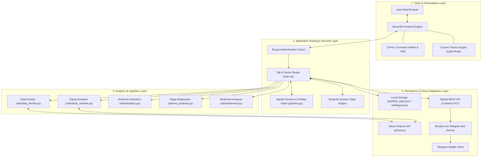
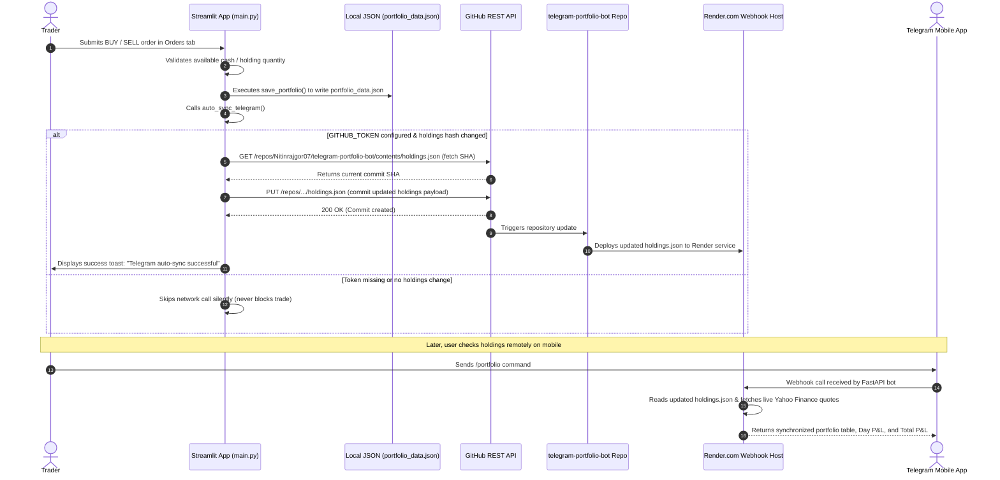

# FintechHub

An enterprise-grade financial analytics and virtual trading application designed for technical market monitoring, paper trading simulation, and automated portfolio synchronization.

[](https://python.org)
[](https://streamlit.io)
[](https://plotly.com)
[](https://scikit-learn.org)
[]()
[](#license)

<br/>

<div align="center">
  
</div>

<br/>

## Table of Contents

- [Overview](#overview)
- [Key Features](#key-features)
- [Application Walkthrough](#application-walkthrough)
- [System Architecture](#system-architecture)
- [Data Flow and Synchronization](#data-flow-and-synchronization)
- [Project Structure](#project-structure)
- [Prerequisites](#prerequisites)
- [Installation and Setup](#installation-and-setup)
- [Configuration Reference](#configuration-reference)
- [Usage Guide](#usage-guide)
- [Security and Data Integrity](#security-and-data-integrity)
- [Troubleshooting](#troubleshooting)
- [Contributing](#contributing)
- [Author](#author)
- [License](#license)

---

## Overview

### The Problem
Retail equity investors and researchers often operate across fragmented platforms: one portal for live quotes, a second for chart technicals, a third for portfolio bookkeeping, and another for messaging notifications. Real-market simulation without capital risk typically requires paid broker sandboxes or cumbersome spreadsheets.

### The Solution
FintechHub unifies market intelligence, technical analysis, simulated order execution, and mobile alert synchronization into a single local web application. It integrates live Indian equity feeds from Yahoo Finance, provides real-time portfolio accounting, renders interactive Plotly visualizations, offers a keyboard-driven command palette, and automatically pushes portfolio state to an external Telegram bot repository.

### Intended Users
- **Retail Investors and Traders:** Practice position sizing, track intraday portfolio shifts against previous close, and monitor market breadth across Indian exchanges.
- **Quantitative and Technical Researchers:** Evaluate technical indicators (RSI, MACD, Bollinger Bands, Moving Averages) and benchmark statistical forecasts against live equity prices.
- **Academic and Capstone Demonstrators:** Review a structured Python architecture combining concurrent data ingestion, cryptographic authentication, and multi-service cloud pipelines.

---

## Key Features

| Feature | Description | Location in Application |
|---|---|---|
| **Bcrypt Authentication** | Salted bcrypt verification for application access with persistent session state. | Login screen |
| **Market Session Engine** | Real-time Indian equity index tracking (Nifty 50, Bank Nifty, Sensex) with market countdown timer (09:15–15:30 IST) and holiday detection. | Header & Dashboard Home |
| **Virtual Portfolio Ledger** | Atomic accounting of invested capital, current valuation, unrealized P&L, day P&L, and STCG/LTCG holding tax lots. | Portfolio tab |
| **Portfolio Allocation Visualizer** | Interactive SVG donut allocation breakdown by equity weight, accompanied by an export-ready Treemap visualization. | Portfolio tab |
| **Simulated Order Terminal** | Instant BUY and SELL order simulation, custom capital allocation, transaction ledger recording, and conditional GTT orders. | Orders tab |
| **Balance Ledger & Quick Add** | Cash balance accounting with one-click liquidity injection (+₹10 Cr, +₹25 Cr, +₹50 Cr) and instantaneous single-click undo. | Balance tab |
| **Multi-Stock Watchlist** | Grouped watchlist supporting single and batch comma/semicolon/newline ticker resolution with live quote ribbons. | Watchlist tab |
| **Indian Equity Resolver** | Robust symbol resolution supporting NSE/BSE tickers, BSE scrip codes, corporate action symbol migrations, and parallel validation. | `utils/stock_resolver.py` |
| **Sector Intelligence** | Dedicated deep-dive dashboards for 5 industry sectors: Defence, Broking, Renewable Energy, EV Tech, and Banking. | Sectors tab (5 sub-pages) |
| **Technical Analytics** | Automated indicator computation: SMA (20, 50), EMA (20), RSI (14), MACD (12, 26, 9), and Bollinger Bands (20, 2σ). | `utils/analytics.py` & Screener |
| **Ridge Regression Predictor** | Multi-step price forecasting using lag features and rolling volatility with 95% confidence intervals. | `utils/ml_predictor.py` |
| **Market News Sentiment** | Headline sentiment analysis from financial feeds with keyword scoring and optional Anthropic Claude API integration. | News tab & Dashboard |
| **Command Palette (Ctrl+K)** | Keyboard-driven modal navigation across all primary pages, sector sub-views, and actions with fuzzy filtering. | Global overlay (`Ctrl+K` / `Cmd+K`) |
| **Automated Telegram Sync** | Non-blocking synchronization of portfolio holdings to an external GitHub repository for consumption by a Telegram bot on Render. | Module-level & Trade execution |

---

## Application Walkthrough

### Login and Session Security
Access to the dashboard is gated by a full-screen authentication form. Passwords entered by the user are verified against a pre-configured bcrypt hash (`APP_PASSWORD_HASH`) stored in `.streamlit/secrets.toml`. Sessions remain active in memory until the browser tab is closed or the user explicitly logs out via the profile dropdown.

### Dashboard (Home)
The primary operational overview presents instantaneous market situational awareness:
- **Header Strip:** Welcome greeting, current Indian Standard Time (IST), session status badge (Open / Closed / Pre-Market), and countdown clock to the next market transition.
- **KPI Summary Cards:** Four high-level metric cards showing Portfolio Current Value, Today's P&L (with timestamp badge `Prices as of HH:MM IST`), Total Active Holdings vs. Watchlist count, and Nifty 50 benchmark performance.
- **Indices & Breadth:** Live quotes for Nifty 50, Bank Nifty, and Sensex, alongside Top 3 Gainers and Top 3 Losers across the NSE universe.
- **Sidebar Panels:** AI market sentiment gauge (Bullish / Neutral / Bearish), Watchlist preview with quick navigation, and latest financial news headlines.

### Watchlist and Stock Resolver
The Watchlist provides continuous quote monitoring with fast batch loading:
- **Add Stock Panel:** Accepts individual tickers or multi-stock strings separated by commas, semicolons, or newlines (e.g., `TCS, INFY, ITC`). Inputs are parsed and resolved via `utils/stock_resolver.py`.
- **Card and Table Views:** Shows current market price, daily change percentage, day's high/low range bar, and 52-week price boundaries.
- **Direct Navigation:** Provides one-click action buttons to open an equity in the order execution terminal.

### Portfolio and Risk Analytics
The Portfolio tab handles complete virtual asset accounting:
- **Summary Banner:** Total Invested, Current Valuation, Overall P&L (₹ and %), Day's P&L (₹ and % vs. previous close), and Cash Balance.
- **Holdings Table:** Detailed positions table displaying ticker, company name, quantity held, average purchase price, current market price, total return, day return, and capital gains tax term (Short Term vs. Long Term based on 365-day holding threshold).
- **Asset Allocation:** Interactive SVG donut visualization illustrating exposure weight per holding, with a collapsible Plotly Treemap component.
- **Sync to Telegram:** A manual trigger button that initiates an immediate payload push to the Telegram bot repository via the GitHub REST API.

### Orders and Execution Terminal
The Orders tab serves as the virtual paper execution environment:
- **Order Placement:** Form for selecting an equity, inputting order quantity, selecting trade type (BUY / SELL), and calculating trade capital.
- **Target & GTT Orders:** Interface for configuring target take-profit prices and stop-loss triggers that execute automatically during active sessions.
- **Audit Ledger:** Chronological record of all executed virtual trades including timestamp, action, quantity, execution price, and realized profit/loss.

### Balance Ledger and Quick Add
The Balance tab manages virtual cash liquidity:
- **Liquidity Summary:** Displays available cash balance, margin utilized across open positions, and total combined equity value.
- **Quick Add Controls:** One-click liquidity addition buttons allowing instant injection of +₹10 Cr, +₹25 Cr, or +₹50 Cr into virtual reserves for large-scale institutional simulation.
- **Undo Facility:** Immediate reversal button to roll back the most recent liquidity injection.
- **Custom Cash Adjustments:** Form input for precise rupee-denominated deposit and withdrawal transactions.

### Sector Deep-Dives
Five dedicated sector intelligence pages provide tailored industry tracking:
1. **Defence & Aerospace:** Tracking public sector defence undertakings and aerospace contractors.
2. **Broking & Fintech:** Monitoring Indian depository participants, stock exchanges, and financial technology platforms.
3. **Renewable Energy:** Analyzing green energy producers, solar equipment manufacturers, and transmission firms.
4. **EV & Auto Tech:** Tracking electric vehicle manufacturers, auto component makers, and battery innovators.
5. **Banking & NBFC:** Comprehensive monitoring of public, private, and non-banking financial corporations.

### Command Palette and Keyboard Navigation
Accessible globally via `Ctrl+K` (or `Cmd+K` on macOS):
- **Modal Search:** Real-time filtering across all application pages, sector sub-views, and shortcuts.
- **Keyboard Navigation:** Full arrow-key navigation (`↑` / `↓`) and `Enter` execution.
- **Direct Shortcuts:** Dedicated key combinations (`Alt+H` for Dashboard, `Alt+W` for Watchlist, `Alt+P` for Portfolio, `Alt+O` for Orders, `Alt+N` for News, `Alt+M` for Market).
- **Floating Action Button (FAB ⚡):** Fixed bottom-right quick-launcher providing mobile-friendly one-tap access to primary pages.

A complete visual layout of all sidebar routes, sector sub-pages, and keyboard shortcut targets is mapped in [`docs/images/navigation-map.svg`](docs/images/navigation-map.svg).

---

## System Architecture

FintechHub is architected in four distinct operational layers:



An SVG export of this diagram is maintained at [`docs/images/architecture.svg`](docs/images/architecture.svg).

### Layer Responsibilities
1. **Client & Presentation Layer:** Streamlit reactive components coupled with inline CSS styling and vanilla JavaScript listeners for global keyboard shortcuts and the command palette.
2. **Application Routing & Security Layer:** Gates all page access behind bcrypt credential validation, tracks session variables, and enforces Indian market session hours and holiday schedules via `patches.py`.
3. **Analytics & Ingestion Layer:** Modular Python utilities performing thread-pooled stock symbol resolution, technical indicator calculation, machine learning forecasting, and news sentiment scoring.
4. **Persistence & Cloud Integration Layer:** Atomic local JSON storage for user portfolios and configuration, combined with outbound GitHub REST API calls to synchronize holdings with an external webhook-driven Telegram bot.

---

## Data Flow and Synchronization

The following sequence details how an order placed in FintechHub updates local storage and propagates to the mobile Telegram bot:



An SVG export of this diagram is maintained at [`docs/images/data-flow.svg`](docs/images/data-flow.svg).

### Core Synchronization Rules
- **Non-Blocking Execution:** Network delays or authentication failures on the GitHub API will never interrupt, revert, or slow down local trade execution.
- **Hash-Based Deduplication:** The synchronization helper computes a SHA-256 hash of the canonical holdings dictionary. If holdings have not changed since the last successful push, redundant GitHub API calls are suppressed.
- **Calculation Parity:** Both the Streamlit dashboard and the Telegram bot compute intraday figures using identical logic:
  - $\text{Stock Day P\&L} = (\text{LTP} - \text{Previous Close}) \times \text{Shares}$
  - $\text{Stock Day \%} = \frac{\text{LTP} - \text{Previous Close}}{\text{Previous Close}} \times 100$
  - $\text{Portfolio Day \%} = \frac{\sum \text{Day P\&L}}{\sum (\text{Previous Close} \times \text{Shares})} \times 100$
  - In pre-market hours (prior to 09:15 IST), intraday figures are zeroed on both interfaces.

---

## Project Structure

```
stock-market-visualization/
│
├── main.py                        # Core Streamlit application, routing, UI, and trade execution
├── patches.py                     # BSE/NSE market holiday calendar (2025–2026) and session patches
├── sync_holdings.py               # Standalone CLI utility for extracting holdings.json from portfolio
├── requirements.txt                # Python package dependency definitions
├── START_APP.bat                  # Windows batch launcher (verifies Python 3.11, installs, and runs)
├── README.md                      # Comprehensive project documentation
│
├── portfolio_data.json            # Persisted virtual portfolio balances, holdings, and order logs
├── holdings.json                  # Cleaned export of active holdings (ticker, shares, avg price)
├── user_preferences.json          # Persisted user interface preferences (density, defaults)
│
├── .streamlit/
│   └── secrets.toml               # Application credentials (APP_PASSWORD_HASH, tokens) [GITIGNORED]
│
├── utils/                         # Modular domain packages
│   ├── analytics.py               # Technical indicators: SMA, EMA, RSI, MACD, Bollinger Bands
│   ├── data_fetcher.py            # Market data retrieval from Yahoo Finance (OHLCV, company info)
│   ├── ml_predictor.py            # Ridge Regression price prediction with volatility bounds
│   ├── portfolio.py               # Portfolio summary table builders and historical valuations
│   ├── sentiment.py               # News sentiment analysis (Claude API client + keyword fallback)
│   ├── stock_resolver.py          # Indian equity symbol resolver (NSE/BSE, corporate actions)
│   └── visualizations.py          # Plotly chart builders (candlestick, RSI, MACD, comparisons)
│
├── docs/                          # Project documentation assets
│   └── images/                    # Vector diagrams, banners, and interface assets
│       ├── banner.svg             # Platform title banner
│       ├── architecture.svg       # Layered system architecture diagram
│       ├── data-flow.svg          # Order execution and Telegram sync sequence diagram
│       └── navigation-map.svg     # Complete application navigation and shortcut map
│
└── output/
    └── stock_data.csv             # Historical market data export cache
```

### Module Responsibility Matrix

| Module | File | Purpose | Primary Functions / Exports |
|---|---|---|---|
| **Core Router** | `main.py` | Primary web application entry point; renders UI, controls state, and processes trades. | `save_portfolio()`, `sync_holdings_to_github()`, `auto_sync_telegram()`, `get_holdings_live_prices()` |
| **Market Calendar** | `patches.py` | Supplies BSE/NSE holiday schedules and determines market session state. | `is_market_open_patched()`, `is_holiday()`, `MARKET_HOLIDAYS` |
| **Holdings CLI** | `sync_holdings.py` | Standalone script for transforming `portfolio_data.json` into a minimal `holdings.json`. | `main()` |
| **Equity Resolver** | `utils/stock_resolver.py` | Maps user queries to verified NSE/BSE tickers, handling corporate splits and renames. | `resolve_and_validate_stock()`, `CORPORATE_ACTION_MAP` |
| **Data Ingestion** | `utils/data_fetcher.py` | Retrieves historical bar data and corporate profile metadata via Yahoo Finance. | `fetch_stock_data()`, `fetch_company_info()` |
| **Technical Analysis** | `utils/analytics.py` | Calculates quantitative technical momentum, trend, and volatility metrics. | `add_indicators()`, `calculate_summary()` |
| **Visualizations** | `utils/visualizations.py` | Generates themed Plotly financial charts, subplots, and overlays. | `create_candlestick_chart()`, `create_rsi_chart()`, `create_macd_chart()`, `create_comparison_chart()` |
| **ML Forecasting** | `utils/ml_predictor.py` | Fits Ridge Regression models over price history for multi-day forecasts. | `predict_prices()` |
| **Sentiment Analysis** | `utils/sentiment.py` | Scans market news headlines using Anthropic Claude or keyword heuristics. | `analyse_sentiment()`, `fetch_news_headlines()`, `generate_simulated_sentiment()` |
| **Portfolio Utility** | `utils/portfolio.py` | Formats portfolio summary dataframes and historical cumulative curves. | `build_portfolio_summary()`, `build_portfolio_history()` |

---

## Prerequisites

Ensure your host environment meets the following specifications before installation:

### System Requirements

| Component | Specification | Purpose |
|---|---|---|
| **Operating System** | Windows 10/11, macOS 12+, or Ubuntu 20.04+ | Host operating system. |
| **Python** | **3.11** (Recommended; verified by `START_APP.bat`) / 3.10+ | Application execution environment. |
| **pip** | 21.0+ | Python package manager. |
| **Git** | 2.30+ | Version control and repository retrieval. |
| **Web Browser** | Chrome, Edge, Safari, or Firefox (modern releases) | Client interface. |
| **Internet Access** | Unrestricted HTTPS outbound | Required for Yahoo Finance quotes and GitHub API synchronization. |

### Optional Accounts and Integrations

| Integration | Required For | Permissions / Configuration |
|---|---|---|
| **GitHub Account** | Automated Telegram bot synchronization | Fine-grained Personal Access Token with **Contents: Read and write** permissions on `Nitinrajgor07/telegram-portfolio-bot`. |
| **Telegram Bot** | Remote mobile portfolio monitoring | Deployed instance of `telegram-portfolio-bot` (hosted on Render.com). |
| **Anthropic API** | Deep learning news sentiment analysis | Anthropic API key (`sk-ant-...`). If omitted, the app uses built-in keyword analysis. |

---

## Installation and Setup

### 1. Clone the Repository
```bash
git clone https://github.com/Nitinrajgor07/stock-market-visualization.git
cd stock-market-visualization
```

### 2. Create and Activate a Virtual Environment

**Windows (PowerShell):**
```powershell
py -3.11 -m venv venv
.\venv\Scripts\Activate.ps1
```

**macOS / Linux (Bash / Zsh):**
```bash
python3.11 -m venv venv
source venv/bin/activate
```

### 3. Install Dependencies
```bash
pip install -r requirements.txt
pip install bcrypt
```

> **Note on Windows Dependencies:** The `START_APP.bat` launcher automatically verifies Python 3.11 and installs required packages including `bcrypt` and `chardet`. If installing manually on Windows without pre-built C++ compilers, use `pip install bcrypt --prefer-binary`.

### 4. Configure Application Secrets
Create a secrets file at `.streamlit/secrets.toml`.

#### Generating a Bcrypt Password Hash
Run the following Python snippet to generate a secure hash for your chosen password:
```python
import bcrypt
password = "YourSecurePassword".encode("utf-8")
hashed = bcrypt.hashpw(password, bcrypt.gensalt()).decode("utf-8")
print(hashed)
```

#### Secrets Configuration Template
Populate `.streamlit/secrets.toml` with the generated hash and optional service credentials:
```toml
# ==============================================================================
# FintechHub Application Secrets
# Location: .streamlit/secrets.toml (Excluded from git tracking)
# ==============================================================================

# Required: Bcrypt hash for application login
APP_PASSWORD_HASH = "REPLACE_WITH_YOUR_GENERATED_BCRYPT_HASH"

# Optional: GitHub fine-grained token for Telegram Bot synchronization
# Requires "Contents: Read and write" on Nitinrajgor07/telegram-portfolio-bot
GITHUB_TOKEN = "REPLACE_WITH_YOUR_GITHUB_PERSONAL_ACCESS_TOKEN"

# Optional: Anthropic API key for AI sentiment analysis (defaults to heuristic if omitted)
ANTHROPIC_API_KEY = "REPLACE_WITH_YOUR_ANTHROPIC_API_KEY"
```

### 5. Launch the Application

**Standard Command:**
```bash
streamlit run main.py
```

**Windows One-Click Launcher:**
Double-click `START_APP.bat` in the repository root. The script checks for Python 3.11, verifies required packages, and starts Streamlit automatically.

The dashboard will open in your default browser at `http://localhost:8501`.

---

## Configuration Reference

### Secrets Reference (`.streamlit/secrets.toml`)

| Key | Type | Required | Description |
|---|---|:---:|---|
| `APP_PASSWORD_HASH` | String | **Yes** | Salted bcrypt hash string used to authenticate the user on the login screen. |
| `GITHUB_TOKEN` | String | No | Personal Access Token used by `sync_holdings_to_github()` to push `holdings.json` to GitHub. |
| `ANTHROPIC_API_KEY` | String | No | API key for Claude 3.5 Sonnet analysis in `utils/sentiment.py`. Falls back to keyword analysis if absent. |

### User Preferences Reference (`user_preferences.json`)

The application automatically reads and persists UI preferences to `user_preferences.json`:

| Configuration Key | Data Type | Default Value | Description |
|---|---|---|---|
| `settings_theme` | String | `"Light Theme"` | Dashboard color theme styling. |
| `settings_accent` | String | `"Blue"` | Primary accent highlight color. |
| `settings_font_size` | String | `"Medium"` | Base interface typography scale. |
| `settings_density` | String | `"Comfortable"` | UI block padding density (`"Compact"`, `"Comfortable"`, `"Spacious"`). |
| `pref_landing` | String | `"home"` | Default tab opened upon initial login (`"home"`, `"portfolio"`, `"watchlist"`). |
| `pref_chart_view` | String | `"Candlestick"` | Default charting visualization mode (`"Candlestick"`, `"Line"`). |
| `pref_watchlist_sort` | String | `"Ticker A-Z"` | Primary ordering applied to the Watchlist grid. |
| `notify_market` | Boolean | `true` | Enables market opening/closing notification banners. |
| `notify_portfolio` | Boolean | `true` | Enables alerts on significant portfolio P&L swings. |

---

## Usage Guide

### 1. Authenticating
When opening the application, enter the plaintext password matching the `APP_PASSWORD_HASH` defined in your secrets file. Upon successful verification, the dashboard session will initialize.

### 2. Adding Stocks to the Watchlist
1. Navigate to the **Watchlist** tab (or press `Alt+W`).
2. Expand the **➕ Add Stock to Watchlist** panel.
3. In the input box, enter a single ticker (e.g., `RELIANCE.NS`) or a batch of tickers separated by commas (e.g., `TCS, INFY, ITC, HDFCBANK`).
4. Click **✅ Add**. The background resolver will validate each symbol against Yahoo Finance and append valid entries to your tracked list.

### 3. Placing a Virtual Trade
1. Navigate to the **Orders** tab (or press `Alt+O`).
2. Select your target equity from the dropdown or type a custom ticker.
3. Enter the number of shares to purchase or sell.
4. Click **BUY** or **SELL**. The order is executed against live market quotes, updating your portfolio cash balance and average purchase price atomically in `portfolio_data.json`.
5. If `GITHUB_TOKEN` is configured, `auto_sync_telegram()` will immediately trigger an asynchronous push to the Telegram bot repository.

### 4. Adding Virtual Liquidity
1. Navigate to the **Balance** tab.
2. In the **Quick Add** panel, click **+₹10 Cr**, **+₹25 Cr**, or **+₹50 Cr** for instant virtual capital injection.
3. If an adjustment was made in error, click **↩ Undo last add** to restore the previous cash balance immediately.

### 5. Synchronizing with the Telegram Bot
- **Automatic:** Every executed trade triggers `auto_sync_telegram()`. If the holdings dictionary differs from the previous commit, the update is pushed to GitHub immediately.
- **Manual:** Navigate to the **Portfolio** tab (or press `Alt+P`) and click **📤 Sync to Telegram**. The application will push the latest `holdings.json` payload directly to the repository.
- **Mobile Access:** Open your Telegram client and send `/portfolio` to your configured bot instance to view real-time synchronized figures.

---

## Security and Data Integrity

| Security Area | Implementation Policy |
|---|---|
| **Credential Storage** | Plaintext passwords are never written to disk or preserved in memory. Passwords are validated using salted bcrypt hashes. |
| **Secrets Isolation** | All external tokens and hashes are isolated to `.streamlit/secrets.toml`, which is explicitly excluded from version control via `.gitignore`. |
| **Zero Financial Exposure** | The platform functions strictly as an offline simulation and paper trading sandbox. No broker order-routing APIs are connected, and real capital is never at risk. |
| **Fine-Grained Permissions** | If utilizing GitHub cloud sync, create a fine-grained Personal Access Token scoped exclusively to repository contents for `telegram-portfolio-bot`. Never grant organizational or administrative scopes. |
| **Local Data Sovereignty** | Ledger files (`portfolio_data.json`, `holdings.json`) reside on the local filesystem. Cloud synchronization to external repositories only occurs when explicitly configured. |

---

## Troubleshooting

| Issue | Probable Cause | Corrective Action |
|---|---|---|
| **`APP_PASSWORD_HASH not set` Error** | Missing `.streamlit/secrets.toml` or missing `APP_PASSWORD_HASH` key. | Create `.streamlit/secrets.toml` and populate it with a valid bcrypt hash as demonstrated in the [Configuration Reference](#configuration-reference). |
| **Invalid Password / Login Rejection** | Password input does not match the bcrypt hash string in secrets. | Re-generate the hash using Python `bcrypt.hashpw()` and ensure no trailing whitespace or quotation errors exist in `secrets.toml`. |
| **`GITHUB_TOKEN secrets.toml mein nahi mila`** | Personal Access Token is absent from secrets. | Provide a valid GitHub Personal Access Token under `GITHUB_TOKEN` in `.streamlit/secrets.toml` to enable Telegram synchronization. |
| **GitHub Sync `403 Forbidden` / `Bad credentials`** | Expired token or insufficient token permissions. | Verify that the GitHub token is active and has **Contents: Read and write** permissions on the target repository. |
| **Yahoo Finance Quote Timeouts / Rate Limits** | High network latency or temporary IP-level request throttling by Yahoo. | Wait 60 seconds for cache expiration (`ttl=60`), or click the refresh icon (`🔄`) on the relevant page. |
| **Sidebar Collapse Reopen Button Not Visible** | Streamlit header CSS hides default navigation controls. | Reopen via `Ctrl+K` command palette navigation, or use direct shortcut combinations (`Alt+H`, `Alt+W`, `Alt+P`). |
| **Missing `bcrypt` Module on Windows Launch** | Running via raw Python rather than activated environment or batch file. | Run `pip install bcrypt --prefer-binary` or execute the application using `START_APP.bat`. |

---

## Contributing

Contributions that improve stability, calculation accuracy, or documentation clarity are welcome:

1. **Fork** the repository on GitHub.
2. **Create a Feature Branch:**
   ```bash
   git checkout -b feature/improvement-name
   ```
3. **Commit Modifications:**
   Follow standard PEP 8 styling conventions. Keep commits atomic and descriptive.
   ```bash
   git commit -m "docs: update calculation references in README"
   ```
4. **Push Branch to Fork:**
   ```bash
   git push origin feature/improvement-name
   ```
5. **Open a Pull Request:** Submit your pull request against the main branch with a clear description of the modifications.

---

## Author

**Nitin Rajgor**  
*M.Sc. Computer Science & Information Technology*  
GitHub: [@Nitinrajgor07](https://github.com/Nitinrajgor07)

---

## License

This repository does not currently include a formal open-source license file (`LICENSE`). All rights are retained by the author. If you intend to use, modify, or distribute this codebase for commercial or public purposes, please contact the author or request the addition of an open-source license (such as the MIT License).
